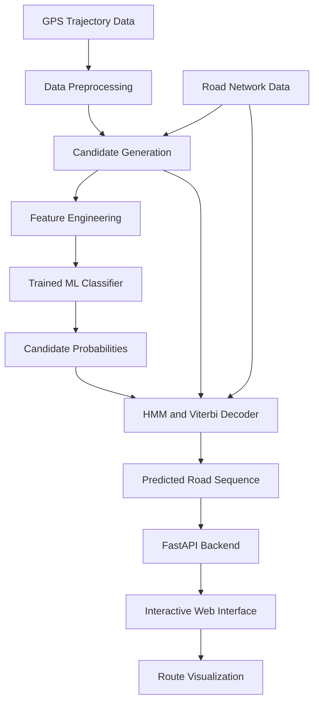

# PathSnap – Machine Learning-Based GPS Map Matching

**PathSnap** is a machine-learning-based GPS map-matching system that identifies the most likely road segments corresponding to noisy GPS trajectories. It combines supervised machine learning, road-network information, and Hidden Markov Model (HMM) sequence decoding to generate accurate and continuous road-matched routes.

The system processes GPS observations, generates candidate road segments, predicts candidate relevance using a trained classification model, and applies the Viterbi algorithm to determine the most likely sequence of road segments. An interactive web interface allows users to select a GPS trip, run route prediction, and visualize the resulting matched route on a map.

---

## Table of Contents

- [1. Overview](#1-overview)
- [2. Problem Statement](#2-problem-statement)
- [3. Objectives](#3-objectives)
- [4. Key Features](#4-key-features)
- [5. System Architecture](#5-system-architecture)
- [6. Technology Stack](#6-technology-stack)
- [7. Project Structure](#7-project-structure)
- [8. Dataset Description](#8-dataset-description)
- [9. Methodology](#9-methodology)
  - [9.1 Data Preprocessing](#91-data-preprocessing)
  - [9.2 Candidate Generation and Feature Engineering](#92-candidate-generation-and-feature-engineering)
  - [9.3 Machine Learning Models](#93-machine-learning-models)
  - [9.4 Model Evaluation and Selection](#94-model-evaluation-and-selection)
  - [9.5 Hyperparameter Optimization](#95-hyperparameter-optimization)
  - [9.6 HMM-Based Sequence Decoding](#96-hmm-based-sequence-decoding)
- [10. Experimental Results](#10-experimental-results)
- [11. Application Workflow](#11-application-workflow)
- [12. Installation and Setup](#12-installation-and-setup)
- [13. Running the Application](#13-running-the-application)
- [14. API and Frontend](#14-api-and-frontend)
- [15. Testing](#15-testing)
- [16. Limitations](#16-limitations)
- [17. Future Enhancements](#17-future-enhancements)
- [18. Contributors](#18-contributors)

---

## 1. Overview

GPS devices are widely used in navigation, transportation, logistics, and location-based applications. However, raw GPS observations are not always aligned with actual road networks. Measurement errors, signal interference, low sampling frequency, and environmental obstacles can cause GPS coordinates to deviate from the roads on which a vehicle is travelling.

PathSnap addresses this problem through **GPS map matching**.

Instead of directly connecting GPS coordinates, PathSnap identifies possible road segments for each observation and uses machine learning to estimate how likely each candidate is to be correct. It then considers road connectivity and movement between consecutive observations to determine a consistent route.

The application combines:

- GPS trajectory preprocessing.
- Road-network-based candidate generation.
- Feature engineering.
- Supervised machine learning.
- Hyperparameter optimization.
- HMM-based sequence decoding.
- FastAPI backend integration.
- Interactive route visualization.

## 2. Problem Statement

Given a sequence of noisy GPS observations and a directed road network, determine the most likely sequence of road segments traversed by the vehicle.

A GPS observation may be located away from the actual road due to positional errors. Furthermore, multiple roads may exist close to the same GPS coordinate, making it difficult to determine the correct road using geographical proximity alone.

The challenge is therefore to identify the correct road segment for every observation while maintaining a geographically and topologically consistent route.

## 3. Objectives

The primary objectives of PathSnap are:

1. Process raw GPS trajectories and road-network data into a usable representation.
2. Generate candidate road segments for individual GPS observations.
3. Extract meaningful spatial and movement-related features.
4. Train and compare multiple machine learning classifiers.
5. Select a model based on generalization performance and observation-level prediction quality.
6. Optimize the selected model's hyperparameters using Optuna.
7. Integrate classifier probabilities with an HMM-based Viterbi decoder.
8. Develop an API that provides route predictions.
9. Build an interactive frontend for visualizing GPS trajectories and matched routes.
10. Evaluate the system using appropriate classification and map-matching metrics.

## 4. Key Features

| Feature | Description |
|---|---|
| GPS Processing | Processes GPS trajectories containing longitude, latitude, and timestamps. |
| Candidate Generation | Identifies possible road segments for each GPS observation. |
| Feature Engineering | Extracts numerical features used to distinguish correct and incorrect candidates. |
| Model Comparison | Evaluates five different machine learning algorithms. |
| Hyperparameter Optimization | Uses Optuna to optimize Logistic Regression regularization strength. |
| HMM Decoding | Uses road connectivity and classifier probabilities to determine a likely route sequence. |
| Viterbi Algorithm | Finds the most likely sequence of hidden road states. |
| REST API | Provides prediction functionality through a FastAPI backend. |
| Interactive Map | Displays GPS observations and predicted routes through a browser-based interface. |
| Evaluation | Measures candidate-level and observation-level prediction performance. |

## 5. System Architecture

PathSnap follows a modular architecture consisting of data processing, machine learning, sequence decoding, backend services, and frontend visualization.



**Major components:**

- **Data Layer:** Stores GPS trajectories, road-network nodes, directed arcs, and reference route information.
- **Preprocessing Layer:** Loads and prepares trajectory and road-network information.
- **Machine Learning Layer:** Generates candidate-level predictions using the selected classifier.
- **Sequence Decoding Layer:** Applies HMM and Viterbi decoding to identify a consistent route.
- **Backend Layer:** Exposes prediction functionality through FastAPI.
- **Frontend Layer:** Allows users to select trips, configure decoding options, and visualize predicted routes.

## 6. Technology Stack

| Category | Technologies |
|---|---|
| Programming Language | Python |
| Machine Learning | Scikit-learn |
| Hyperparameter Optimization | Optuna |
| Numerical Processing | NumPy, Pandas |
| Model Serialization | Joblib |
| Backend | FastAPI |
| ASGI Server | Uvicorn |
| Frontend | HTML, CSS, JavaScript |
| Map Visualization | Leaflet |
| Testing | Pytest |
| Version Control | Git and GitHub |

## 7. Project Structure

The following structure represents the major project components. Refer to the repository for the complete and current directory contents.

```text
PathSnap/
│
├── api/
│   ├── config.py
│   ├── main.py
│   ├── schemas.py
│   ├── services.py
│   ├── hmm_decoder.py
│   └── README.md
│
├── artifacts/
│   └── model.joblib
│
├── frontend/
│   └── index.html
│
├── src/
│   ├── hmm.py
│   └── optimization/
│       ├── optuna_search.py
│       └── optimized_logistic_regression.py
│
├── tests/
│   ├── test_api.py
│   ├── test_hmm.py
│   ├── test_optuna_search.py
│   ├── test_optimized_logistic_regression.py
│   ├── test_final_refit_evaluation.py
│   └── test_application_integration.py
│
├── reports/
│   ├── figures/
│   └── optimization/
│
├── benchmarks/
│   └── benchmark_inference.py
│
├── requirements.txt
└── README.md
```

**Directory descriptions:**

- `api/`: Contains backend configuration, request/response schemas, prediction services, and the HMM decoder adapter.
- `artifacts/`: Contains the serialized trained model used during inference.
- `frontend/`: Contains the browser-based map visualization interface.
- `src/`: Contains the core machine learning and sequence-decoding implementation.
- `src/optimization/`: Contains Optuna-based hyperparameter search and optimized model implementation.
- `tests/`: Contains unit, API, model, and integration tests.
- `reports/`: Contains experimental summaries, evaluation outputs, and generated figures.
- `benchmarks/`: Contains inference benchmarking utilities.

## 8. Dataset Description

PathSnap uses GPS trajectories and corresponding road-network information.

The dataset is organized around individual trips.

### 8.1 Input Files

| File | Description |
|---|---|
| `.track` | Contains GPS observations, including longitude, latitude, and timestamp. |
| `.nodes` | Contains road-network node coordinates. |
| `.arcs` | Contains directed connections between road-network nodes. |
| `.route` | Contains the ordered reference arc IDs associated with a trip. |

### 8.2 Road Network Representation

The road network is represented using nodes and directed arcs.

- **Nodes:** Represent geographical points in the road network.
- **Arcs:** Represent directed road connections between nodes.
- **Arc IDs:** Correspond to the row indices of the arc data.
- **Node IDs:** Correspond to the row indices of the node data.

The direction of an arc is important because road movement may not be possible in both directions.

### 8.3 Dataset Split

The project uses:

- 80 trips for model development and training.
- 10 student-test trips for development-stage evaluation.

Group-aware validation is used to ensure that observations from the same trip are not distributed across training and validation partitions.

The trip `00000000` does not contain the required `.arcs` file in the student-test data and is therefore excluded from the final labelled evaluation. No reference data or evaluation results are fabricated for this trip.

## 9. Methodology

### 9.1 Data Preprocessing

Raw GPS data cannot be directly used for reliable road identification. Therefore, preprocessing is performed before model training.

The preprocessing workflow includes:

1. Loading GPS trajectories and road-network data.
2. Extracting GPS coordinates and timestamps.
3. Reading road-network nodes and directed arcs.
4. Generating candidate road segments for GPS observations.
5. Preparing candidate-level training examples.
6. Constructing binary classification labels using reference route information.
7. Handling missing or invalid values.
8. Preparing numerical features for machine learning.

Reference route information is used to construct training labels and evaluate predictions. It is not provided as an input feature to the prediction model.

### 9.2 Candidate Generation and Feature Engineering

For every GPS observation, PathSnap identifies possible road segments that could correspond to the observed location.

Rather than predicting a road segment directly from all possible arcs, the system performs binary classification on individual observation-candidate pairs.

Each candidate is represented using numerical features that help the classifier distinguish between likely and unlikely matches.

The classification problem is:

- **Class 1:** Correct candidate.
- **Class 0:** Incorrect candidate.

The model estimates the probability that a candidate is the correct match.

This approach allows the system to evaluate multiple possible road segments for the same GPS observation.

### 9.3 Machine Learning Models

Five machine learning algorithms were compared.

**1. Logistic Regression**

Logistic Regression is a supervised classification algorithm that estimates the probability of a candidate belonging to the positive class.

It was selected as the final model based primarily on its observation-level Top-1 performance.

**2. Decision Tree**

Decision Trees classify observations using a sequence of feature-based decision rules. They can capture non-linear relationships and are relatively easy to interpret.

**3. Random Forest**

Random Forest is an ensemble learning algorithm that combines predictions from multiple decision trees. It helps capture complex relationships and reduces dependence on an individual tree.

**4. Multi-Layer Perceptron (MLP)**

MLP is a feed-forward neural network capable of learning non-linear relationships through multiple layers of interconnected neurons.

**5. K-Nearest Neighbours (KNN)**

KNN classifies a candidate based on the labels of nearby training examples in feature space.

All five models were evaluated using a consistent candidate-classification task and group-aware validation.

### 9.4 Model Evaluation and Selection

The models were evaluated using multiple metrics to understand both classification quality and map-matching performance.

| Metric | Purpose |
|---|---|
| Accuracy | Measures the proportion of correctly classified candidates. |
| Precision | Measures how many predicted positive candidates are actually correct. |
| Recall | Measures how many actual positive candidates are successfully identified. |
| F1-score | Harmonic mean of precision and recall. |
| Confusion Matrix | Shows true positives, true negatives, false positives, and false negatives. |
| ROC-AUC | Measures the model's ability to distinguish between positive and negative candidates. |
| Log Loss | Measures the quality of predicted probabilities. |
| Observation-level Top-1 | Measures how often the highest-scoring candidate is the correct candidate for an observation. |
| Candidate Miss Rate | Measures the proportion of observations for which the correct candidate is unavailable or missed. |

**Why observation-level Top-1 matters**

A GPS observation can have several possible road candidates. The model must rank these candidates so that the most likely correct candidate receives the highest score.

Observation-level Top-1 evaluates whether the highest-ranked candidate is correct. This metric is particularly relevant to the candidate-selection stage of PathSnap.

Group-aware cross-validation is used to evaluate generalization across trips rather than allowing observations from the same trip to appear in both training and validation partitions.

### 9.5 Hyperparameter Optimization

After selecting Logistic Regression, Optuna was used to optimize its regularization parameter.

Optuna is a hyperparameter optimization framework that searches for parameter values that improve a specified objective.

**Optimization configuration:**

| Parameter | Configuration |
|---|---|
| Optimization Framework | Optuna |
| Sampler | Tree-structured Parzen Estimator (TPE) |
| Number of Trials | 30 |
| Validation Strategy | Nested GroupKFold |
| Outer Folds | 5 |
| Inner Folds | 4 |
| Optimization Objective | Maximize observation-level Top-1 |
| Search Parameter | C |
| Search Range | 0.0001 to 1000 |

**Selected hyperparameters:**

| Hyperparameter | Selected Value |
|---|---|
| C | 2.778663410880327 |
| Solver | lbfgs |
| Maximum Iterations | 1000 |
| Random State | 42 |
| Imputation | Median Imputation |
| Feature Scaling | StandardScaler |

The parameter `C` controls the inverse strength of regularization in Logistic Regression. A smaller value applies stronger regularization, while a larger value applies weaker regularization.

The optimized configuration was used for the final model refit.

### 9.6 HMM-Based Sequence Decoding

Selecting the highest-probability road candidate independently for each GPS observation may result in an inconsistent route.

For example, two individually likely road candidates may not be connected in the road network.

To address this issue, PathSnap incorporates a Hidden Markov Model (HMM) and the Viterbi algorithm.

**Hidden Markov Model**

The HMM represents route matching as a sequence prediction problem.

It consists of:

- **Hidden States:** Candidate road segments corresponding to GPS observations.
- **Emission Probabilities:** Represent how likely a GPS observation is given a candidate road segment.
- **Transition Probabilities:** Represent how likely movement between consecutive candidate road segments is.

The classifier's predicted probabilities contribute to the emission information used by the decoder.

Road connectivity and spatial movement contribute to transition evaluation.

**Viterbi Algorithm**

The Viterbi algorithm finds the most likely sequence of hidden states given the observations and transition/emission probabilities.

The algorithm works by:

1. Initializing possible states for the first observation.
2. Calculating emission and transition contributions.
3. Recursively finding the best path to each candidate state.
4. Maintaining the best predecessor for each state.
5. Backtracking through the stored predecessors.
6. Producing the most likely sequence of road segments.

The implementation also accounts for unreachable transitions, invalid arc endpoints, and observations without valid candidates.

**Classifier vs. HMM**

| Classifier-Only Prediction | HMM + Viterbi |
|---|---|
| Scores candidates independently. | Considers the sequence of observations. |
| Selects the highest-probability candidate. | Finds the most likely sequence of candidate states. |
| Does not inherently enforce road connectivity. | Uses transition information and road connectivity. |
| May produce discontinuous routes. | Aims to produce more consistent routes. |

The classifier provides candidate probabilities, while HMM/Viterbi uses these probabilities together with transition information to determine a route sequence.

---

## 10. Experimental Results

### 10.1 Model Comparison

The model comparison stage evaluated five classifiers using group-aware cross-validation.

The following observation-level Top-1 results were recorded:

| Model | Observation-Level Top-1 |
|---|---:|
| Logistic Regression | 0.8404 ± 0.0420 |
| Random Forest | 0.8284 ± 0.0605 |
| MLP | Approximately 0.81 |
| Decision Tree | Refer to model comparison results |
| KNN | Refer to model comparison results |

Logistic Regression was selected because it achieved the strongest reported observation-level Top-1 performance among the compared models.

Random Forest achieved a lower log loss in the recorded comparison, but Logistic Regression was selected based primarily on the project's Top-1 objective.

### 10.2 Hyperparameter Optimization Results

The selected regularization parameter was:

`C = 2.778663410880327`

The nested cross-validation results were:

| Metric | Result |
|---|---:|
| Observation-Level Top-1 | 0.8402 ± 0.0418 |
| Candidate Accuracy | 0.9260 ± 0.0218 |
| Log Loss | 0.1893 ± 0.0431 |
| Training Time | Approximately 4.95 seconds |
| Inference Time | Approximately 0.105 seconds |

The baseline and optimized validation protocols should be interpreted separately. The results do not establish a direct improvement from hyperparameter tuning because the validation protocols differ.

### 10.3 Final Student-Test Evaluation

The final tuned Logistic Regression pipeline was fitted using 646,978 reliable candidate rows from 79 eligible training trips.

The model was then evaluated on the available labelled student-test data.

<details>
<summary>Final evaluation metrics</summary>

| Metric | Final Result |
|---|---:|
| Candidate Accuracy | 0.940310 |
| Precision | 0.825038 |
| Recall | 0.857671 |
| F1-score | 0.841038 |
| ROC-AUC | 0.973235 |
| Log Loss | 0.160370 |
| Observation-Level Top-1 | 0.873152 |
| Candidate Miss Rate | 0.000499 |

</details>

**Evaluation coverage:**

- Student-test trips available: 10.
- Trips successfully evaluated: 9.
- Labelled candidate rows: 54,381.
- Labelled observations: 10,017.
- Trip `00000000` excluded because its `.arcs` file was missing.

The results indicate that the selected model can distinguish between correct and incorrect road candidates with strong classification performance.

The final evaluation results should be interpreted in the context of the available labelled trips and the stated evaluation limitations.

---

## 11. Application Workflow

The complete application follows this workflow:

1. The user opens the PathSnap web interface.
2. The available student-test trips are retrieved from the backend.
3. The user selects a trip.
4. The user selects the decoding method: classifier-based prediction or HMM/Viterbi decoding.
5. The frontend sends a prediction request to the FastAPI backend.
6. The backend loads the corresponding GPS trajectory and road-network information.
7. Candidate features are generated and passed through the trained model.
8. The model returns candidate probabilities.
9. If HMM/Viterbi is selected, the decoder uses the candidate probabilities and road-network transitions to determine a likely sequence.
10. The backend returns prediction results and GPS observation coordinates.
11. The frontend displays the GPS observations and predicted route on the interactive map.

## 12. Installation and Setup

### 12.1 Prerequisites

Ensure that the following are installed:

- Python 3.10 or a compatible project-supported version.
- Git.
- A modern web browser.
- The project dataset.

The actual Python version and dependency requirements should be checked against the repository's configuration.

### 12.2 Clone the Repository

```bash
git clone <https://github.com/yashita164/PathSnap>
cd PathSnap
```

### 12.3 Create a Virtual Environment

**Windows:**

```powershell
python -m venv venv
```

Activate it:

```powershell
.\venv\Scripts\Activate.ps1
```

If PowerShell blocks script execution, use:

```cmd
venv\Scripts\activate.bat
```

### 12.4 Install Dependencies

```bash
pip install -r requirements.txt
```

If the project uses a different dependency file, follow the repository's installation instructions.

### 12.5 Configure Dataset Paths

PathSnap supports configuring the dataset root through the `PATHSNAP_DATA_ROOT` environment variable.

For example:

```powershell
$env:PATHSNAP_DATA_ROOT = "D:\pathsnap-data"
```

The data directory should contain the expected student-test trip structure:

```text
student_test/
    00000001/
        00000001.track
        00000001.nodes
        00000001.arcs

    00000002/
        00000002.track
        00000002.nodes
        00000002.arcs
```

The actual dataset directory must follow the structure expected by the application.

### 12.6 Configure the Model Path

The trained model is stored at:

```text
artifacts/model.joblib
```

The API supports the `PATHSNAP_MODEL_PATH` environment variable for overriding the default model location.

For example:

```powershell
$env:PATHSNAP_MODEL_PATH = "artifacts\model.joblib"
```

The default configuration should resolve the project-relative model path automatically.

---

## 13. Running the Application

Start the FastAPI application from the project root.

```powershell
python -m uvicorn api.main:app --host 127.0.0.1 --port 8000
```

Alternatively, when using the project's virtual environment directly:

```powershell
.\venv\Scripts\python.exe -m uvicorn api.main:app --host 127.0.0.1 --port 8000
```

Once the server starts, access the application through:

**Web Interface:**

```text
http://127.0.0.1:8000/
```

**API Documentation:**

```text
http://127.0.0.1:8000/docs
```

The frontend is served by the FastAPI application, so a separate frontend development server is not required.

### Running Across Two Laptops

For a demonstration using two computers connected to the same reachable network:

**Laptop 1 – Backend**

Start the backend using:

```powershell
python -m uvicorn api.main:app --host 0.0.0.0 --port 8000
```

Find the Laptop 1 IPv4 address using:

```cmd
ipconfig
```

**Laptop 2 – Frontend**

Open a browser and navigate to:

```text
http://<LAPTOP-1-IP>:8000/
```

Both laptops must be able to communicate over the network. Firewall settings or Wi-Fi client isolation may prevent access.

Only use this setup on a trusted network.

---

## 14. API and Frontend

### 14.1 Backend

The backend is implemented using FastAPI.

Its responsibilities include:

- Loading the trained model.
- Resolving dataset and artifact paths.
- Processing prediction requests.
- Generating candidate probabilities.
- Supporting classifier-based and HMM/Viterbi decoding.
- Returning prediction results to the frontend.

The API is responsible for keeping reference information separate from model inference. Reference route labels must not be exposed to the prediction model.

### 14.2 Frontend

The frontend provides an interactive interface built with HTML, CSS, JavaScript, and Leaflet.

Its main functionalities include:

- Retrieving available trips.
- Selecting a GPS trip.
- Choosing a decoding method.
- Triggering route prediction.
- Displaying loading and error states.
- Visualizing GPS observations.
- Displaying the predicted road-matched route.

### 14.3 Map Visualization

The interactive map helps users understand the difference between raw GPS observations and the predicted route.

It displays geographical information returned by the backend, allowing users to inspect the predicted route spatially rather than relying only on numerical evaluation metrics.

---

## 15. Testing

Testing is performed across multiple components to verify correctness and integration.

| Testing Area | Purpose |
|---|---|
| Model Tests | Verify model loading, prediction, and probability outputs. |
| Optimization Tests | Validate Optuna search and optimized model functionality. |
| HMM Tests | Verify sequence decoding, transitions, reachability, and invalid candidate handling. |
| API Tests | Validate backend prediction endpoints and response handling. |
| Integration Tests | Verify the interaction between the model, decoder, backend, and application. |
| Final Evaluation Tests | Validate the final model evaluation workflow. |

The implementation's recorded focused test results include:

- 61 targeted API, HMM, and integration tests passed.
- 3 separate configuration integration tests passed.
- 32 focused finalization regression tests passed, with one test deselected.

These are targeted test results and should not be interpreted as proof that every test in the repository has passed.

To execute the test suite:

```bash
pytest
```

For more detailed output:

```bash
pytest -v
```

---

## 16. Limitations

The current implementation has certain limitations:

1. **Incomplete Student-Test Data:** One student-test trip does not contain the required `.arcs` file and cannot be evaluated using reference labels.
2. **GPS Quality:** The accuracy of map matching depends on the quality and sampling frequency of the GPS observations.
3. **Candidate Generation:** If the correct road segment is not included among the generated candidates, the classifier cannot select it.
4. **Road-Network Connectivity:** Incorrect or incomplete road-network information can affect transition evaluation and route decoding.
5. **Evaluation Coverage:** Final labelled evaluation results are based on nine successfully evaluated student-test trips.
6. **Deployment Environment:** Network accessibility between separate laptops depends on network configuration, firewall rules, and client isolation.

## 17. Future Enhancements

Potential future improvements include:

- Improving candidate generation to reduce candidate miss rate.
- Exploring additional spatial and temporal features.
- Evaluating more advanced classification algorithms.
- Investigating alternative hyperparameter optimization strategies.
- Improving HMM transition modelling and handling of long GPS gaps.
- Adding route-level visualization and detailed prediction diagnostics.
- Improving frontend usability and prediction result interpretation.
- Evaluating the system on larger and more diverse GPS datasets.
- Performing broader end-to-end testing across different deployment environments.


## Conclusion

PathSnap demonstrates an end-to-end machine learning approach to GPS map matching by combining candidate-level classification with probabilistic sequence decoding.

The project compares five machine learning algorithms, selects Logistic Regression based on observation-level Top-1 performance, and uses Optuna to optimize its regularization parameter. The resulting classifier is integrated with an HMM-based Viterbi decoder to incorporate road-network connectivity and sequential movement information.

Through its FastAPI backend and interactive Leaflet-based frontend, PathSnap provides a complete workflow for selecting GPS trips, generating route predictions, and visualizing matched routes.

The project illustrates how machine learning, probabilistic modelling, graph-based road-network information, and web technologies can be combined to solve a practical location-intelligence problem.

---

**Project:** PathSnap  
**Domain:** Machine Learning | GPS Map Matching | Intelligent Transportation Systems  
**Primary Model:** Optimized Logistic Regression  
**Sequence Decoder:** Hidden Markov Model with Viterbi Algorithm  
**Backend:** FastAPI  
**Frontend:** Leaflet-based Web Interface
